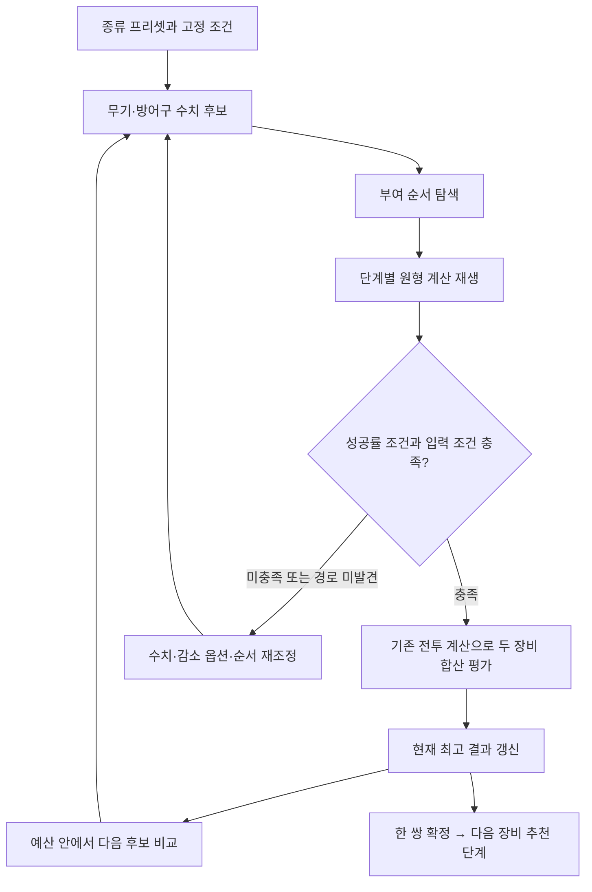

# 옵션 부여 추천 알고리즘 설계안

자동 옵션 부여의 설계안이다. [사용자 정리](../statting.md), [원형 조사](../verification/toram-statting-extraction.md), [가상 입력·대량 실험](../verification/toram-statting-experiments.md)을 기준으로 한다. 오프라인 실험기는 제공하며 앱 추천은 보류다. 사용자 원문은 수정하지 않는다. 줄 수·비용은 실제 단계별 규칙을 따르고, 옵션 후보마다 크리스타 탐색을 반복하지 않는다.

## 1. 설계 범위

사용자가 스테이터스·스킬·요리를 설정하고 **옵션 종류의 프리셋 하나**를 선택하면, 무기·방어구의 옵션 수치와 실제 부여 순서를 결정한다. 그 결과를 하나로 확정한 뒤 보조·추가·특수장비·크리스타 추천 단계에 넘긴다.

옵션 수치 하나를 바꿀 때마다 크리스타 전역 추천을 다시 실행하지 않는다. 옵부 단계 내부에서는 단계별 잠재력 시뮬레이션과 기존 전투 계산만 사용한다. 무기와 방어구는 서로의 크리티컬률·크리티컬 대미지 등을 합산해 평가하지만, 각 장비의 잠재력과 부여 경로는 독립이다.

최초 목표는 **선택한 프리셋과 탐색 예산 안에서 좋은 결과를 찾는 것**이다. 프리셋 밖의 옵션이나 조사하지 않은 순서까지 포함한 전역 최적을 보장하지 않는다.

## 2. 고정 조건과 시작 잠재력

| 구분 | 기준 |
| --- | --- |
| 옵션 부여자 | Lv325, TEC255 |
| 제작자 | Lv325, 제작 잠재력이 최대가 되도록 기본 스탯 배분 |
| 제작 스탯 예산 | 사용자 지정에 따라 현행 앱의 Lv325 포인트 규칙 사용 |
| 잠재력 증가 스킬 | 만렙 |
| 시작 장비 | 장비 카테고리별 플레이어 제작 대상 중 가장 높은 기초 잠재력의 장비 |
| 시작 옵션 | 기본 실험은 옵션이 없는 제작 성공품. 기존 옵션이 있는 장비는 별도 입력 |
| 크리스타 슬롯 | 기본 실험은 잠재력 감소가 없는 조건. 제작 시 슬롯 때문에 잠재력이 줄어든 개체는 별도 프로필 |

현행 `status-points.js`의 `pointBreakdown(325,325)`는 `650+165+25=840`이다. 이는 5개 기본 스탯 값의 합 예산이며 기본값1도 포함한다. 제작자는 이 예산을 전부 사용한다. 예를 들어 관련 스탯510·327, 나머지 기본 스탯1·1·1을 배분할 수 있다. 개인 스탯 TEC255를 제작자에게도 강제로 배정하지 않는다.

단일 스탯 제작은 해당 스탯510으로, 두 스탯 제작은 관련 합837로 보너스를 최대화한다. 사용자 정리의 단일 `/10`, 쌍 `/20` 기준 보너스는 각각51·41이다. 게임의 한계돌파 조건과 상한도 통과하는 배분이어야 하며, 두 스탯을 모두510으로 두지 않는다. 앱 포인트 예산을 채택한 사실과 서버 훈장 포인트를 전수 확인한 사실은 구분한다.

시작 잠재력은 다음 과정을 통해 **카테고리별 프로필**로 만든다.

1. 아이템 ID와 플레이어 제작 레시피를 연결한다. NPC/드롭 전용·제작 실패품을 섞지 않는다.
2. 해당 카테고리의 최대 기초 잠재력과 같은 값을 가진 모든 장비를 기록한다.
3. 만렙 잠재력 증가 스킬의 적용 순서·절삭을 반영하고 제작 스탯 보너스를 더한다.
4. 선택 장비 ID·원본 기초 잠재력·제작 배분·스킬 보정·제작 후 시작 잠재력을 따로 보존한다.

현재 보존 원본에서 확인한 최대 기초 잠재력은 [무기9종67, 몸장비63](../../data/sources/toram-statting/native-crafting/base-profiles.json)이다. 제작 스탯 배분은 [앱 예산·원형 상한 검증](../../data/sources/toram-statting/native-stat-budget/README.md)에 보존했다. 제작 스킬 +30%의 정확한 원형 절삭 순서는 아직 확인하지 못했다. 이번 실험은 이를 숨기지 않고 다음 두 조건부 초기값으로 나눴다.

| 제작 보정 가설 | 단일 스탯 무기 | 두 스탯 무기 | 몸장비 |
| --- | ---: | ---: | ---: |
| 합산 후 절삭 `base+floor(base×.30)+bonus` | 138 | 128 | 132 |
| 각각 절삭 `base+floor(base×.10)+floor(base×.20)+bonus` | 137 | 127 | 132 |

모든 추적에 `startingPotentialNativeVerified:false`를 남긴다. 비교 가능한 무기763건 중273건의 최선 경고율이 달랐고 최대 차이는9%p였다. 따라서 실제 추천 활성화 전에는 제작 후 초기값을 확인해야 한다. 두 가설이 가능한 실제 구현 전부를 포함한다는 의미도 아니다. **초기 제작 모델의 미확정과 이후 부여 비용의 원형 번역 검증은 별개다.**

동률 장비의 ATK·안정률까지 같다고 가정하지 않는다. 시작 잠재력이 같아도 전투 평가에 쓰는 실제 장비는 구분한다. 최고 잠재력 장비를 사용하는 비교 기준과, 현재 플레이어가 제작 가능한 레시피인지도 별도 표시한다. 제작 가능 시기·숙련도 조건을 모르면 현재 획득 가능하다고 단정하지 않는다.

## 3. 프리셋은 수치가 없는 틀

프리셋에는 무기·방어구 각각 다음만 둔다.

- 반드시 포함할 증가 옵션의 종류
- 추가하거나 교체할 수 있는 증가 옵션의 종류
- 허용하는 감소 옵션의 종류
- 속성 부여 여부와 대상 속성, 반전옵이라면 반전할 옵션의 종류

크리티컬 대미지12%, 크리티컬률32 같은 수치를 프리셋에 저장하지 않는다. 수치는 Lv325 상한·잠재력·성공률 조건·전투 효과를 계산해 결정한다. 사용자가 수치를 잠그면 그것은 프리셋과 별도의 실행 제약이다.

확옵·도박옵·반전옵도 프리셋과 분리한다. 같은 옵션 틀로도 허용 실패 확률에 따라 결과가 달라질 수 있기 때문이다. 프리셋 여러 개를 내부에서 모두 실행하는 기능은 첫 구현에 넣지 않는다.

증가 옵션의 틀과 감소 옵션의 허용 풀도 구분한다. 감소 후보는 무기·몸장비별 DoubleUse, 반환량, 카테고리와 전투 손해를 계산한다. 조사에 사용한 무기의 `HP 자연회복-/MP 자연회복-/회피%-`를 몸장비에 그대로 고정하지 않는다. 몸장비에는 별도로 `MATK%-/마법관통%-/HP 자연회복%-` 등 물리용 풀을 조사했다. 이는 실험용 풀이고 모든 빌드에서 손해가 없다는 보증은 아니다.

## 4. 추천 문제를 두 부분으로 나누되 서로 피드백한다



최종 옵션의 잠재력 비용을 합산해서 먼저 유효성을 확정하지 않는다. 같은 옵션도 순서에 따라 비용이 달라지므로, 경로를 찾고 재생한 후보만 실제 가능한 결과로 채택한다. 제한된 경로 탐색에서 못 찾은 것은 ‘불가능’과 구분한다.

## 5. 수치 후보를 만드는 방식

전체 수치 조합을 처음부터 펼치지 않는다. 먼저 다음 지점으로 시작 후보를 만든다.

- 옵션이 처음 들어가는 최소값, 잠재력 단가가 바뀌는 경계, Lv325 상한
- 현재 빌드에서 필수 크리티컬률 등 요구치를 맞추는 값
- 부여 경로에서 잠재력을1 근처까지 쓰거나 절삭 잔여를 줄일 수 있는 값

그 뒤 합법적인 한 단계 증감과 두 옵션 간 교환을 비교한다. 한 옵션을 낮추고 다른 옵션을 올리는 이동, 무기에서 줄이고 방어구에서 늘리는 이동을 함께 고려한다. 단가 경계와 전투 계산의 절삭 때문에 한 단계 변화의 점수가0이어도 이후 가치가 없다고 삭제하지 않는다. 필요한 경우 다음 효과 발생 지점까지의 묶음 변화도 비교한다.

`대미지 증가량/잠재력 증가량`은 조사 순서를 정하는 참고값으로 사용한다. 분모가0이거나 카테고리가 바뀌는 이동에는 그대로 적용하지 않는다. 감소 옵션도 반환량만으로 고르지 않고 완성 빌드의 손해와 줄 수를 함께 평가한다. 최초 버전은 이 과정을 근사 탐색으로 취급한다.

전투 점수는 기존 계산기를 재사용한다. 캐릭터·스킬·요리·대상은 고정하고 두 제작 장비의 옵션만 교체한다. 나머지 장비·크리스타는 사용자가 현재 설정한 값을 ‘평가 기준 세팅’으로 고정해 사용하며, 이후 추천에서도 같은 기여량을 얻는다고 보장하지 않는다. 이 가정을 결과에 남긴다. 자동으로 미래 크리스타의 기여량을 만들어 넣지 않는다.

실험의 기존 앱 평가144회에서, 같은 CR+1의 평타 기대 계수 증가는 외부 CR 기여0/50일 때42, 기여80으로 이미 포화된 경우0이었다. CR을 무조건 상한까지 올리는 규칙은 사용하지 않는다. 다만 이 probe는 고정 한손 평타 한 사례이며 마법/스킬의 요구치와 결과를 대신하지 않는다.

속성 유리도 후보 틀에는 유지한다. 현재 앱의 `FIRE_DMG` 등 원시 DTE 키는 보존되지만 `notModeled`이며 일반 `ELEM_P`와 자동으로 같아지지 않는다. **대상 속성에 맞는 효과 연결을 검증하기 전에는 DTE를 포함한 대미지 순위를 확정하지 않는다.** 평가되지 않은 효과를0점으로 취급해 후보에서 제거하지 않는다.

## 6. 부여 경로 탐색

네 가지 경로 계열을 비교한다. 어느 하나를 무조건 정답으로 고정하지 않는다.

| 경로 | 만드는 방법 | 비교할 부분 |
| --- | --- | --- |
| 마이너스 먼저 | 감소 옵션을 부여한 후 증가 옵션 마무리 | 단순 경로의 기준 결과 |
| 선소진 후 반환 | 증가 옵션 일부로 잠재력을 소진 → 감소 옵션 반환 → 나머지 마무리 | 반환 전후 카테고리·남겨 둔 잠재력 |
| 분할 사용 | 위 경로 중 1pt 옵션 등의 변화를 여러 번으로 나눔 | 합산 후 절삭을 단계마다 받는 이익과 실제 행동 수 |
| 소량 음수 혼합 | 소량 감소와 양수 추가를 같은 행동으로 실행 → 감소 나머지 → 마무리 | 양·음 행 비용을 합산한 뒤 패널티·절삭을 받는 차이 |

작은 완전탐색에서 처음 세 계열만으로는87%, 혼합 행동을 허용하면88%인 합법 입력이 나왔다. 현재는 이 계열을 추가해12개 소형 기준 입력 모두 최대 경고율이 일치한다. 본 실험1,670건에서는 혼합 계열의 단독 점수 우위가 없었지만 몸장비 추가83건 중2건에서는 다른 계열보다 높았다. 흔하지 않다는 이유로 삭제하지 않는다.

‘잠재력1 만들기’는 탐색 목표이지 모든 입력에서 가능한 전제가 아니다. 합법적인 수치 조합으로1에 도달할 수 없으면 도달 가능한 다른 잔여값도 비교한다. 크리티컬률을 조정용으로 쓰더라도 마지막 필요한 수치에 도달할 여지를 남긴다.

감소 옵션은 한꺼번에 넣기와 카테고리별·일부만 먼저 넣기를 비교한다. 반환 때의 패널티가 커지더라도 이후 소비 패널티까지 커질 수 있으므로 최종 경로로 판단한다. 이미 있던 옵션도 이후 카테고리 계산에 계속 포함한다.

마지막에는 ‘모든 나머지를 한꺼번에’와 ‘일부를 분할한 뒤 나머지를 한꺼번에’를 비교한다. 중간 단계도 확률 조건을 검사한다. 기본 확옵·도박옵 탐색에서는 마무리 전 단계는100%인 경로를 우선 대상으로 하며, 중간 도박을 허용하는 확장은 별도 정책으로 둔다.

경로 상태에는 순서 있는 현재 옵션/슬롯, 현재 잠재력, 미완료 목표와 지원하는 행동 정책을 둔다. 카테고리는 두 번째 등장 때 원형 dictionary에 삽입되므로 옵션의 삽입 순서도 보존한다. 같은 최종 수치라도 이 상태가 다르면 합치지 않는다. 반복 동작은 화면에서 압축할 수 있지만 시뮬레이션은 매번 실행한다. 나누기와 합치기가 같다는 검증 없이 반복을 일괄 비용으로 바꾸지 않는다. 미확인인 보호 슬롯은 현재 실험 상태에 생성하지 않는다.

현재 큰 도메인 실험은 최소값 양수 부분집합을 만든 뒤 옵션 하나를 단위 증가시켜 선소진한다. 옵션 종류별 낮은 잔여 잠재력 대표와 전체 하위8개 대표만 남기며, 음수는 완성값으로 부여하는 모든 순서 있는 묶음을 비교한다. 마무리에서 단가1·DoubleUse0인 옵션을 BaseMax/상한까지 분할한다. 혼합 경로는 빈 상태/양수 하나1에서 양수1 증가+음수1~4를 같은 행동으로 비교한다. 이 범위를 벗어난 선소진·음수 분할은 미탐색이다.

이 대표 축소는 휴리스틱이다. 동일한 **순서 있는 옵션 값·정책 상태**에서 잔여 잠재력이 더 큰 상태로 합치는 것은 최대 bounded 경고율만을 목표로 하는 단조 탐색에서 별도로 검증한다. 행동 수/소재/반전 확률까지 함께 최적화한다면 잠재력 하나로 지배 판정을 하지 않고 해당 비용과 경로도 보존해야 한다.

## 7. 단계 계산과 마지막 단계 판정

단계마다 원형의 ‘기존 값→변경량→최종 옵션’으로 비용을 계산한다. 장비별 DoubleUse, ±BaseMax 구간, OverRate, TEC 반환율, 행별 절삭, 최종 카테고리 배율과 합산 후 절삭 순서를 그대로 따른다. 표시 단위를 바로 내부 값으로 사용하지 않는다.

구간 초과 시 양수 소비의2배와 음수 반환의0.5배를 구분한다. ‘소모와 반환이 모두 두 배’라는 하나의 규칙으로 만들지 않는다.

추가로 확인한 [실행 전 성공률 경고 계산](../../data/sources/toram-statting/native-success/README.md)은 다음과 같다.

```text
D = max(원본 장비의 기초 잠재력, 현재 잠재력)
A = 100 + 강화 스킬 보너스
경고 확률 = max(0, trunc_float32(A - (100 / D) × (단계 비용 - 현재 잠재력) × 2.3f))
```

float32 연산은 각 연산마다 적용한다. 강화 스킬 세 개가 Lv10이면 A=160이다. 현재 잠재력이 원본 기초 잠재력보다 작은 경우, 사용자 정리의 단순 ‘부여 직전 잠재력 분모’와 차이가 있다. 제작 후 시작 잠재력을 분모 하한으로 대체하지도 않는다.

다만 기본 경로처럼 감소 옵션으로 잠재력을 충분히 늘린 뒤 마무리하면 현재 잠재력이 원본 기초 잠재력보다 크다. 이 경우 분모 보정은 결과에 영향을 주지 않는다. 이 차이는 실험기의 경계 처리이며, 경로 추천의 핵심 개선 항목으로 취급하지 않는다.

마지막 잠재력은 음수가 될 수 있다. 음수라는 이유만으로 실패 처리하지 않고 위 계산과 선택한 확률 조건으로 판정한다. 반대로 중간 단계 뒤 더 부여하려면 다음 행동을 시작할 수 있는 잠재력·빈 줄 조건이 필요하다. 8줄을 다 채운 뒤에도 마음대로 다음 단계를 실행할 수 있다고 가정하지 않는다.

실행 전 경고 계산과 서버에서 각 옵션이 실제 성공하는 규칙은 구분한다. 확률100% 경로도 서버 행동 전수 검증이 끝났다는 의미로 표시하지 않는다.

## 8. 확옵·도박옵·반전옵

확옵은 마지막 단계의 표시 확률100%를 제약으로 한다. 도박옵은 사용자가 정한 최소 표시 확률을 제약으로 한다. 80~99%라는 일반적 범위를 시스템 고정값으로 넣지 않는다. 제작 성공률을 완성 장비의 대미지에 곱해 전투 점수를 만들지 않는다.

완성 확률은 별도 결과다. 독립 판정과 동일 확률p가 성립하고 보호되지 않은 판정이m개라면, 모두 성공할 확률은 p^m이다. 사용자 이미지의99%→96.06%는 0.99^4와 대응한다. 다만 어떤 줄이 판정을 받고 보호되는지는 실제 규칙을 확인한 후 계산해야 한다. 중간 단계에 도박이 있으면 마지막 확률만으로 전체 성공률을 표시하지 않는다.

반전옵은 ‘부여 시도 옵션’과 ‘원하는 완성 옵션’을 별도 벡터로 둔다. 실패가 목표인 줄의 실제 반전 결과·보호 위치·부호/수치 규칙을 확인한 뒤, 원하는 결과에 도달하는 사건들의 확률을 합산한다. 실패 결과를 단순히 부호 반대로 생성하는 코드는 근거 없이 만들지 않는다.

사용자 정리의 p^3(1-p)는 지정된 한 줄 실패와 다른 세 줄 성공이 필요한 사건이면 맞다. 하지만 네 줄 중 한 줄이 확정 보호되고 나머지 세 줄에서 지정된 한 줄 실패가 필요하다면 p^2(1-p)다. 각각 최대 지점은75%·약66.67%로 다르다. 지정된 실패 줄인지, 어느 줄이든 한 줄 실패인지도 조합계수가 달라진다. 이 구분을 피드백으로 확정해야 한다. 보호·반전 결과가 미확인인 상태에서는 반전옵 설계와 가정 계산만 제공하고 제작 보장 결과를 내지 않는다.

## 9. 가상 입력기와 실험

앱과 분리된 오프라인 실험기로 시작한다. 입력은 카테고리별 최대 잠재력 프로필과 단계별 변경 옵션이다. 수치 범위를 벗어난 입력을 자동 보정해 실험하지 않고 이유와 함께 거부한다.

| 검사 | 거부 또는 분리할 입력 |
| --- | --- |
| 제작 프로필 | 예산840 초과, 스탯510 초과, 한계돌파 미충족, 근거 없는 시작 잠재력 |
| 옵션 | 미등록 ID, Lv325 방향별 상한 초과, 한 행동의 중복 Type, 가용 줄 수 초과 |
| 단위 | 표시값/내부값 변환이 확인되지 않은 옵션을 같은 수치로 투입 |
| 단계 | 변화 없는 행동, 0값 슬롯의 임의 유지/삭제, 다음 행동 조건 위반 |
| 결과 | short/int 오버플로를 활용한 이득, 미확인 반전·서버 결과를 확정값으로 사용 |

추적 결과는 행동마다 변경 옵션, 이전/이후 옵션, 현재/이후 잠재력, 행별 기본 비용, 카테고리별 개수와 배율, 최종 비용, 경고 확률을 남긴다. 반복 횟수와 실제 펼쳐진 행동 수도 구분한다.

실험은 두 층으로 진행했다. 작은 합법 도메인은 가능한 단조 행동을 완전탐색해서 기준 정답을 만든다. 실제 Lv325 상한 도메인은 네 경로 계열과 경계 주변을 비교했다. 입력1,753개·입력 내 중복 제거 경로1,211,496개, 소형 기준12건/492,202전이 모두 최대 경고율 일치다. 별도로 일반 옵션60종의 경계11,666경로/65,390전이를 조사했다. 전체 옵션 조합·반전·수치 역행을 전수 검증한 것은 아니다. 소형 기준을 두 실행에서 반복한 것을24개의 독립 기준으로 세지 않는다.

가상 입력기·추적·재현 명령은 [tools/statting/README.md](../../tools/statting/README.md)에 있다. 저장된63개 경로 추적을 재생해 비용·잠재력·경고율을 검산했다. 사용자 이미지에는 최초 잠재력 등 일부 입력이 없어 그대로 완전 재현했다고 주장하지 않는다.

## 10. 실험을 반영한 추천 순서

다음은 앱에 옮길 설계이며 외부 수치 탐색 자체는 아직 구현하지 않았다.

1. **실행 조건 고정.** 종류 프리셋, 장비 ID/초기 잠재력, 목표 공격, 타겟, 나머지 장비의 고정 기여, 최소 경고율을 묶는다. 지원하지 않는 효과나 초기값 근거 누락을 먼저 표시한다.
2. **출발 수치 생성.** 최소값·BaseMax·상한·실제 전투 요구치 경계에서 소수의 출발점을 만든다. 처음부터 모든 수치의 데카르트 곱을 펼치지 않는다. 무기와 몸장비의 감소 후보 풀은 각각 계산한다.
3. **저렴한 경로부터 확인.** 마이너스 일괄→양수 일괄을 기준으로, 단가1 분할, 선소진/분할, 소량 음수 혼합 순으로 탐색을 넓힌다. 원형 계산기는 모든 단계에서 동일하다. 제한된 대표에서 미발견이면 수치 조정과 추가 경로 중 어느 쪽에 예산을 쓸지 정하며 불가능으로 표시하지 않는다.
4. **통과한 두 장비를 합산 평가.** 전투 요구조건 충족을 우선하고 기존 평가기의 목적함수로 비교한다. 표시 경고율을 대미지에 곱하지 않는다. 감소 옵션의 손해도 함께 넣는다.
5. **수치 이동.** 각 옵션±1, 단가·전투 절삭 경계를 넘는 묶음 이동, 옵션 간 교환, 무기↔몸 간 이전을 비교한다. 허용 풀 안의 감소 옵션 교체도 비교한다. 한 번의 증감이0점이어도 그 이후를 삭제하지 않는다. 여러 출발점에서 개선이 멈추거나 예산을 다 쓰면 지금까지 최고 한 쌍을 고른다.
6. **최종 재생 후 확정.** 채택 경로를 캐시와 별도로 다시 재생하고 최종 옵션·슬롯·경고율·전투 점수를 검산한다. 한 쌍을 확정한 뒤3단계 추천을 한 번 실행한다.

같은 성능에서는 높은 경고율→적은 행동 수를 잠정 동점 기준으로 둔다. 특정 최종 옵션의 **통과 여부만** 확인하는 동안에는 경고율100%를 찾으면 더 높은 경고율은 없으므로 탐색을 멈출 수 있다. 행동 수 최소화는 최종 후보에 별도로 적용한다. 이 중단을 더 강한 수치 후보의 생성까지 멈추는 조건으로 쓰지는 않는다.

실험1,670건에서 단순 경로가 이미 동점인975건에는 둘 다 미발견인553건이 포함된다. 따라서 ‘58%는 단순 경로면 충분하다’고 해석하지 않는다. 결과를 찾은 것 중 단순 경로 동점422건, 경고율 개선695건이었다. 값 하나마다 항상 전체 경로 계열을 끝까지 도는 구현도 피한다.

캐시는 `(게임 계산 버전, 제작 프로필, 최종 옵션의 순서와 값, 행동 정책)`의 경로 결과와, 별도의 고정 빌드+두 장비 옵션 전투 평가를 둔다. 미발견 결과에는 탐색 예산/계열도 붙여 확장 탐색을 차단하지 않는다. 입력 변경 시 해당 캐시를 구분한다. 목표는 경로 평가 재사용과 불필요한 크리스타 재실행 제거다. 이번434.96초/1,670입력의 오프라인 조사 시간으로 앱 응답시간을 보장하지 않는다.

## 11. 결과와 다음 단계 연결

결과는 무기·방어구의 최종 옵션 한 쌍, 각 장비의 부여 순서와 추적표, 평가 기준 세팅에서의 성능, 표시 확률과 별도의 완성 확률/미확인 사항을 포함한다. 경로 미발견·예산 종료·입력 오류를 구분한다. 조사 범위 밖까지 ‘최적’이라고 부르지 않는다.

확정 시에만 선택한 두 장비의 옵션을 적용한다. 사용자가 잠근 옵션과 다른 장비의 수동 옵션을 지우지 않으며, 기존 옵션에 결과를 중복 가산하지 않는다. 3단계 추천은 이 입력 하나로 실행한다. 3단계에서 부족/과잉이 발견되면 이유를 보여 주고, 사용자가 옵부를 다시 조정할 수 있게 한다. 자동 반복 실행은 첫 설계에 넣지 않는다.

실제 구현 시 전투 평가는 현재 공용 Rust 코어와 Application 계산 경계를 재사용한다. 실험기에 별도 전투 계산식을 만들지 않는다. 원형 비용 시뮬레이터와 추천 경로 탐색은 분리해, 빠른 탐색이 계산식 자체를 근사하지 않도록 한다.

## 12. 피드백할 결정

1. 첫 추천 범위를 확옵·도박옵으로 시작하고, 반전옵은 보호/실패 결과 확인 후 활성화하는가?
2. 프리셋의 필수 옵션은 최소1이라도 반드시 포함하는가, 또는 별도 필수 수치를 사용자 제약으로 받는가?
3. 평가 기준은 현재 나머지 장비·크리스타를 쓰는가, 필수 수급 목표를 별도로 배정하는가?
4. 같은 성능이면 높은 완성 확률→적은 행동 수 순으로 선택하는가? 소재식 확인 후에는 소재량도 동점 기준에 추가할 수 있다.

가상 입력·대량 경로 비교·소형 기준 검산·기존 전투 평가 probe까지 실행했다. 앱 추천·자동 적용·저장 계약·공동 전역 탐색은 구현하지 않았다. 제작 초기값 절삭, 특수 operand 왕복, DTE 대상 연결, 보호/서버 실패 결과·소재량이 남아 있다. [실험 보고서](../verification/toram-statting-experiments.md)의 범위와 Gate를 다음 구현의 기준으로 사용한다.
