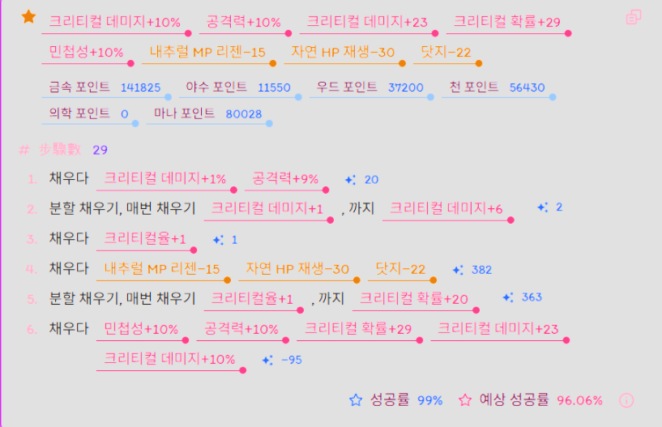

# 옵션 부여란
유저제 장비에 원하는 옵션을 부여하는것.

## 잠재력
만들어진 장비가 가질 수 있는 수치값.
장비의 기초 잠재력과 제작자의 스텟에 비례한 보너스 포텐셜을 합하여 산정되며 크리스타 슬롯 수에 따라 포텐셜이 일부 깎인채로 제작되기도 한다.

### 제작자의 스테이터스별 보너스 포텐셜

한손검 : (STR+DEX)/20
지팡이 : INT/10
양손검 : STR/10
마도구 : (INT+AGI)/20
발도검 : (DEX+AGI)/20
활    : (STR+DEX)/20
선풍창 : (STR+AGI)/20
자동활 : DEX/10
권갑 : AGI/10
방어구 : VIT/10

## 옵션 부여 방식의 종류
1. 확옵
최종 옵션이 결정되는 단계에서 표시되는 확률이 100%인 옵션 부여. 안정적인 옵션을 위해 이용한다.

2. 도박옵
최종 옵션이 결정되는 단계에서 표시되는 확률이 100%가 아닌 옵션부여. 조금 더 높은 옵션을 위해 실패할 확률을 감수해야 하며 각 옵션의 성공률이 독립시행으로 작용하기 때문에 실제로 원하는 옵션이 성공할 확률은 표기된 수치보다 낮다. 주로 80~99% 부근을 의미한다.

3. 반전옵
각 옵션이 실패 할 때 설정한 값의 반대 부호의 값이 나올 수 있음을 유도하여 옵션을 부여하는 방법. 양수 옵션이 4개 이고 성공 확률이 n 이라고 가정 할 때 (n**3)*(1-n)가 최댓값이 되는 n의 지점을 찾는 것을 목표로 한다. (대장장이 스킬의 옵션 실패 방지를 이용하여 실제로 확률에 영향을 주는 옵션은 3줄이다.)
사람에 따라 2개의 옵션을 반전하는 것을 유도하는 사람도 있다. 다만 확률이 매우 매우 낮다.

## 옵션 부여 식을 만드는 방법

토람온라인의 옵션 부여에는 패널티 시스템이 존재한다. 같은 카테고리의 옵션을 플러스 마이너스 상관 없이 부여하기만 하면 5*(n**2) (n은 2이상의 옵션 갯수) 만큼의 패널티가 주어진다.

옵션 부여 성공률 식 : 160 + 230 × (남은 잠재력 / 이전 잠재력)

위 식에 의해 이전 잠재력이 많아야 좋아서 단순히 '마이너스 옵션을 먼저 넣고 그 다음 플러스로 마무리 한다'를 하면 될 것 같지만 패널티 시스템에 의해 그게 아닌 경우가 있다.

[예시]

패널티로 증감하는 양이 너무 많기 때문에 기존 존재하던 잠재력을 패널티 받고 이용하면 손해를 보게 된다. 때문에 잠재력을 패널티 이전에 소진, 패널티 이후 내림 계산과 1당 1pt 짜리 옵션을 이용해서 낭비되는 pt를 최소화하여 순서를 정한다.

보통 위와 같은 케이스는
1. 플러스 옵션으로 패널티를 늘리면서 잠재력이 딱 1이 남도록 옵션을 부여한다. 이때 크리티컬률 (잠재력 1pt 짜리 옵션)을 정확히 1이 되도록 설계해야 한다.
2. 마이너스 옵션으로 패널티를 극대화 하면서 반환 받는 잠재력을 최대화한다.
3. 늘어난 패널티를 버림 계산을 이용해 (1pt*1.65의 내림 = 1) 잠재력 사용에서 이득을 본다.
4. 옵션 부여 성공률 식에서 이전 잠재력이 높아야 좋음을 알 수 있으므로 나머지 옵션은 한번에 부여한다.

와 같은 순서로 옵션 부여 식을 만든다.

만약 패널티가 그렇게 강하지 않다면 그냥
1. 마이너스 옵션을 먼저 넣어서 현재 잠재력을 뻥튀기한다.
2. 플러스 옵션을 한번에 넣는다.
로 정리 할 수 있을것이다.

이때 마이너스 옵션에서의 패널티는 조절 할 수 있다. 때문에 플러스 옵션에서의 패널티가 20% 인 경우에 굳이 마이너스 옵션에서 패널티를 늘리지 않고 옵션을 부여하기도 한다. 이는 계산을 바탕으로 행해져야 한다.

## 옵션의 수치를 정하는 기준
보통 옵션은 특정 기준을 넘어가면 잠재력의 소모/반환량이 2배가 된다. 때문에 잠재력을 효율적으로 쓰는 구간에서 최대 효율을 누릴 수도 있고, 스테이터스 1%p당 대미지 증감률을 통해 각 옵션의 가치를 환산하여 잠재력의 효율을 계산하기도 한다.
이것 또한 계산을 통해 정립 할 수 있다.

# 레퍼런스

https://gall.dcinside.com/mgallery/board/lists/?id=toramonline
토람 온라인 갤러리의 옵션 부여 관련 글을 통해 일반적인 경우, 특수한 경우 등을 알 수 있다.
마이너스 옵션을 선정하는 방법, 옵션의 수치를 정하는 방법 등 여러가지 정보들의 출처이다.
